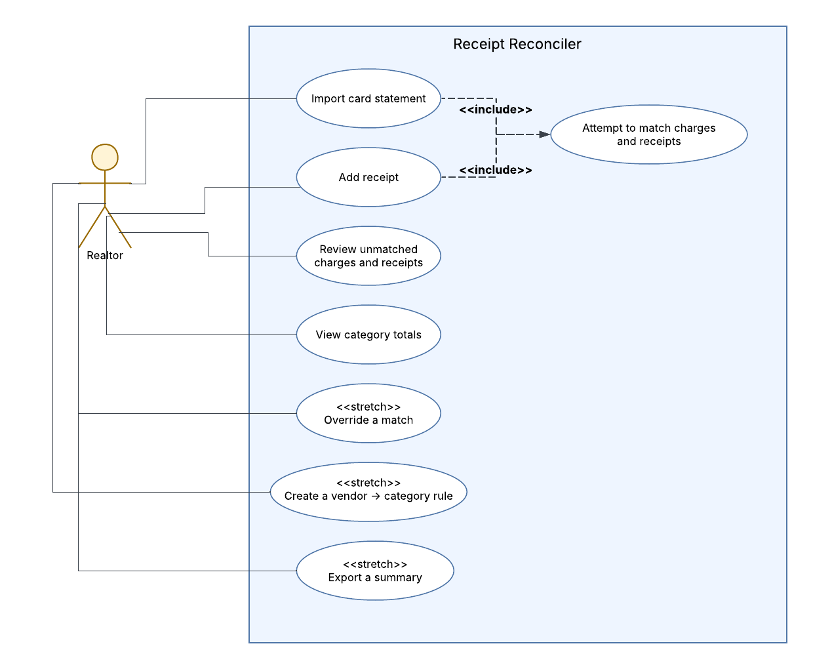

# Use Cases
## Actors and Use Cases
The realtor reconciles card charges against receipts and checks spending by category. Redis and the matcher are internal components of Receipt Reconciler.

| Scope | Actor | Use Case | Outcome |
| --- | --- | --- | --- |
| Core | Realtor | Import card statement | Statement charges are available for reconciliation, and the Realtor can see which still need receipts. |
| Core | Realtor | Add receipt | The Realtor records one receipt manually or adds a batch from a CSV. |
| Core | Realtor | Review unmatched charges and receipts | The Realtor can identify charges missing a receipt and receipts still missing a corresponding charge. |
| Core | Realtor | View category totals | The Realtor sees the total spending assigned to each category. |
| Stretch | Realtor | Override a match | The Realtor corrects an incorrect charge-receipt pairing. |
| Stretch | Realtor | Create a vendor -> category rule | Future spending at that vendor is assigned to the chosed category. |
| Stretch | Realtor | Export a summary | The Realtor downloads a summary of reconciliation results and category totals. |

## Import card statement
1. The Realtor selects **Import card statement** and supplies a statement CSV.
2. Receipt Reconciler checks that it can read the transaction date, vendor description, and amount for each charge.
3. The system saves the charges and attempts to match them against receipts already on file.
4. The Realtor sees how many charges were imported, how many matched, and how many still need receipts.

**Failure case: unexpected CSV layout**
At step 2, the system cannot identify the amount column. It stops before saving any charges, identifies the missing field, and lets the Realtor correct the header and retry.

## Add receipt
1. The realtor selects **Add receipt** and chooses manual entry or CSV upload.
2. For manual entry, the Realtor enters the date, vendor, and amount. For CSV upload, the Realtor selects a file with those fields for each receipt.
3. The system validates the submission and saves the receipts.
4. The system checks for corresponding statement charges and shows the result. If the charge has yet to arrive, the receipt remains available for the next statement import.

**Failure case: invalid amount**
At step 3, a receipt contains an unreadable amount. The system identifies the amount field (and row for a CSV), leaves the submission unsaved, and lets the Realtor correct it and retry.

# Use Case Diagram
