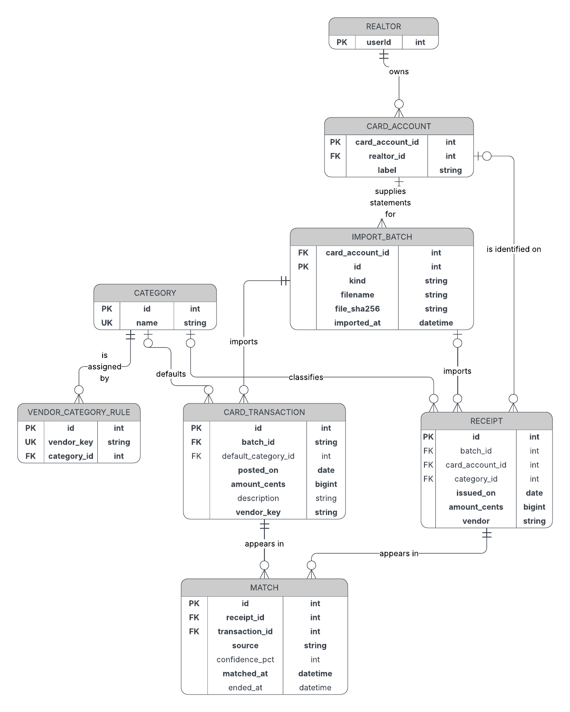

# Receipt Reconcilier Entity-Relationship Diagram
One Realtor can own multiple USD card accounts. Each statement belongs to one account. Spending totals use the charges on the selected accounts.

## Design Decisions
| Question | Decision |
| --- | --- |
| How is money stored? | Parse decimal input directly into signed 64-bit integer cents. For example, $19.90 becomes 1990. Normalize purchases to positive amounts and refunds to negative amounts on both sides. Reject fractions of a cent. The matcher compares cents exactly and uses vendor and date to distinguish equal amounts. |
| Where does a match live? | A separate `MATCH` row records the receipt, charge, source, algorithm confidence, and time the pairing began and ended. This preserves the original decision when the Realtor overrides it. |
| How many matches are allowed? | A receipt and a charge can each have zero or one active match and many historical matches. Every match references exactly one of each. Two independent unique indexes enforce the active limit. |
| Where does category live? | The receipt holds the Realtor's optional category. A charge holds an optional default category assigned by a vendor rule at import. For spending totals, an active receipt's category wins, followed by the charge's default, then Uncategorized. |

## Diagram
The lines to `MATCH` count all historical rows.


## Constraints
**Account selection and matching**: The realtor selects the card account when importing a statement. Each charge inherits its account through its batch. A receipt can identify the card used, even before its statement arrives. When it is unknown, the matcher searches across the Realtor's accounts. If two cards have equally plausible charges, the receipt stays unmatched for review.

**Pairing and override history**: Require both match foreign keys. The sketch's unconditional unique constraints would prevent a receipt or charge from being re-paired while retaining its old match. Apply uniqueness only to open rows.

```
CREATE UNIQUE INDEX one_active_match_per_receipt
    ON "MATCH" (receipt_id) WHERE ended_at IS NULL;

CREATE UNIQUE INDEX one_active_match_per_charge
    ON "MATCH" (transaction_id) WHERE ended_at IS NULL;
```

On override, close any active matches involving the selected receipt or charge, then insert the manual match in the same database transaction. If insertion fails, roll back the closures. A displaced counterpart becomes unmatched. The automatic matcher only pairs unmatched records.

**Duplicate imports**: A filename records provenance, but renaming a CSV must not allow a second import. Require `kind` and the SHA-256 digest of the original bytes. Require an account for a statement batch and a null account for a receipt batch, which can contain purchases from several cards. Use a unique index on `(card_account_id, file_sha256)` for statement batches and a separate unique index on `file_sha256` for receipt batches. This lets two accounts import identical statement bytes while blocking a repeat import for the same account. Commit the batch and its validated rows together. Each charge belongs to a statement batch. A CSV receipt belongs to a receipt batch, while a manually entered receipt has no batch. This detects identical files even after renaming. Detecting overlapping statements or reformatted exports would require a stable source transaction ID or a separate duplicate-review workflow.

**Vendor rules and totals**: Use the same merchant normalization when creating a rule and importing a charge. One normalized vendor key maps to one category. Copy the rule’s category onto each new charge so editing a rule affects future imports. For a per-card report, filter statement batches by account. For a combined report, include every account. In either case, start with each charge exactly once and look up its active receipt, if any. For example, if a $45 charge defaults to Office Supplies and its receipt says Marketing, count $45 under Marketing. An unmatched charge still counts. An unmatched receipt stays in the review list until its charge arrives.

**Summary export**: The export uses the same active matches and category totals as the review screen. It needs no additional entity.